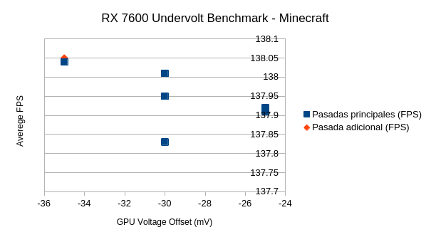

# rx7600-undervolt-benchmark
## Overview: I tested how GPU voltage offsets affect frame rate and reported GPU power on my Radeon RX 7600 in Minecraft.

## Test setup:
Hardware:
- GPU: RX 7600
- CPU: Ryzen 5 5600G
- RAM: 16GB DDR4-3200 (3200 MT/s)

## Software:
- OS: Bazzite (Based on Fedora Atomic Desktop)
- Kernel: 7.3.5-ogc3.1.fc45.x86_64
- Game: Minecraft Java Edition version 26.3
- GPU tunning: LACT
- Benchmark logging: MangoHud

## Graphics Settings:
- Shader pack: Complementary Reimagined r5.9.3
- Shader preset: Very High
- Resolution: 1920x1080
- Render distance: 16 chunks
- Simulation distance: 12 chunks

## BIOS Configuration and Baselines
| Test phase | GPU voltage offset | Above 4G Decoding | Resizable BAR |
|---|---:|---|---|
| Pre-change baseline | 0 mV (stock) | Disabled | Disabled |
| Undervolt baseline | 0 mV (stock) | Enabled | Enabled |
| Undervolt trials | −25, −30, −35, and −40 mV | Enabled | Enabled |

The pre-change baseline used kernel `7.3.4-ogc10.1.fc45.x86_64`.
The post-change tests used `7.3.5-ogc3.1.fc45.x86_64`.
Because both BIOS settings and the kernel changed between the two
stock-voltage baselines, that comparison cannot isolate the effect
of Resizable BAR.
The post-change 0 mV runs serve as the stock-voltage reference for the
undervolt trials. The stock-voltage CSV filenames contain `pre_bios`
or `post_bios` to identify the corresponding baseline.
[Download the stock-voltage CSV files](./rx7600-stock-baselines/)

## Results

Each point represents one benchmark run. The additional -35 mV run was recorded after returning to -25 mV.

## Conclusion

In the final Minecraft session, the -25, -30 and -35 mV offsets avaraged 137.92 - 138.03 FPS at about 134 W of reported GPU power. The -25 mV reference differed by 1.83 FPS between sessions, while the three offset avareges in the final session differed by only 0.11 FPS.

In the final benchmark session, −35 mV had the highest average frame rate at 138.03 FPS, just 0.11 FPS ahead of −25 mV. Both settings averaged about 134 W of reported GPU power. I kept −25 mV as my provisional daily setting after playing Minecraft for about four hours without encountering any issues.
